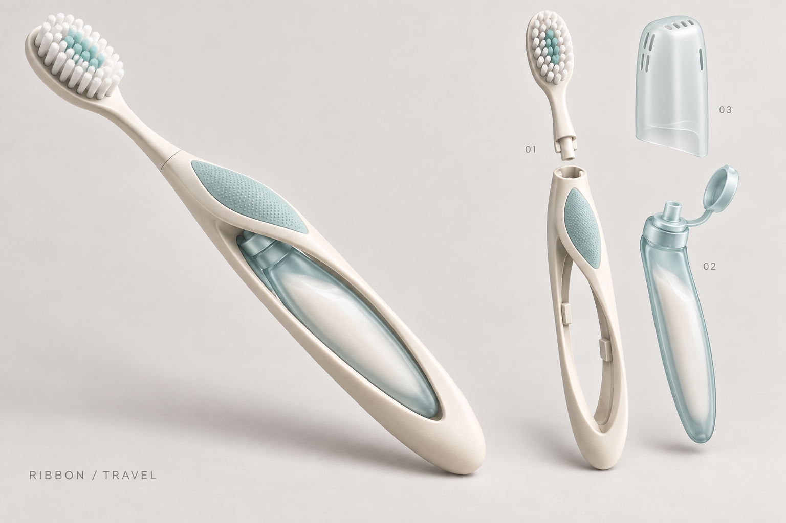
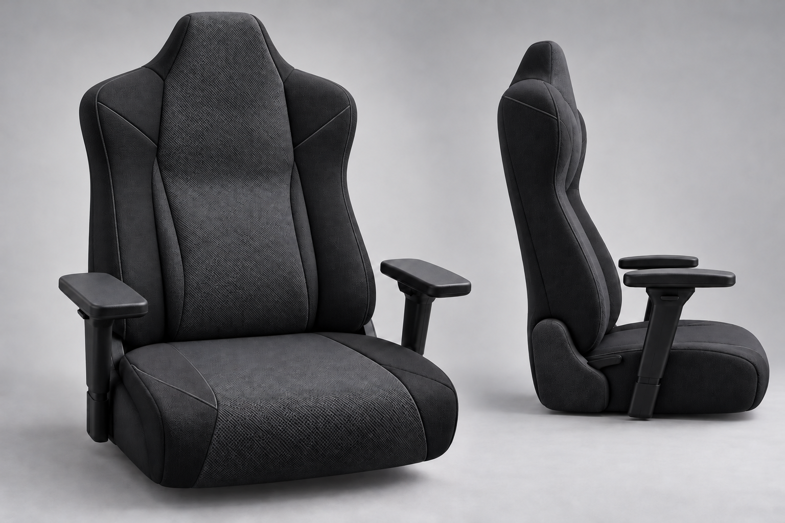

# Product Designer

이미지·스타일·사용 목적을 바탕으로 웹·앱과 실물 제품을 설계하는 개인용 Codex 스킬과 디자인 작업 기록입니다.

## 사용

이 저장소를 작업 폴더로 열고 다음처럼 요청합니다. 프로젝트 스킬은 `.agents/skills/product-designer/`에 있습니다.

> $product-designer 이 이미지의 비례와 분위기를 참고해서 새 제품을 디자인해줘. 실제 사용과 제작 방법까지 고려해줘.

> $product-designer 여행용 칫솔을 새로 디자인해줘. 치약 수납과 교체형 헤드를 넣어줘.

다른 프로젝트에서 쓰려면 해당 환경의 개인 스킬 폴더에 `product-designer` 폴더를 복사합니다. 스킬은 이미지 생성·웹 조사·CAD 도구를 자체 포함하지 않습니다. 현재 환경에 있는 도구를 선택해서 사용하며, 실행할 수 없는 검증은 미검증으로 기록합니다.

## 구성

| 경로 | 내용 |
|---|---|
| [.agents/skills/product-designer/SKILL.md](.agents/skills/product-designer/SKILL.md) | 작업 선택·조사·디자인·검증의 중심 지침 |
| [.agents/skills/product-designer/references/](.agents/skills/product-designer/references/) | 디지털·실물·조사·검증·출처 자료 |
| [docs/스킬작동원리.md](docs/스킬작동원리.md) | 판단 로직과 현재 한계 |
| [docs/제품디자이너_검증기록.md](docs/제품디자이너_검증기록.md) | 스킬 파일 검사와 수동 검토 기록 |
| [designs/게이밍의자/](designs/게이밍의자/) | 사용자 사진·참고 자료·수정 시안·프롬프트·제작 조건 |
| [designs/칫솔/](designs/칫솔/) | 리본 루프와 여행용 치약 포드·교체 헤드 콘셉트 |

## 최신 검토 시안

사용자 만족·양산 승인까지 확정한 완성 설계는 아닙니다. 여러 버전과 반려 기록을 함께 보존합니다.

### 리본 트래블

### 메쉬 게이밍의자 — 머리·날개 비율 수정

## 검증 범위와 자료

스킬은 파일 형식·내부 링크·UI 메타데이터 검사를 통과했습니다. 디자인 이미지는 내장 이미지 생성 도구로 만든 외형 콘셉트이며 CAD·금형·강도·누수·착좌·구강 사용·원가를 검증한 결과가 아닙니다.

조사 출처 27개와 실제 확인 범위는 [sources.md](.agents/skills/product-designer/references/sources.md)에 있습니다. 참고 이미지·사용자 제공 사진·생성 시안은 각각 출처와 성격이 다릅니다. 이 저장소는 제3자 자료의 권리를 새로 부여하지 않습니다.

기록 속 `D:/confactory/`와 사용자 디렉터리는 제작 당시의 원본 위치입니다. 이 저장소에서는 위 상대 경로를 사용합니다. API 키·토큰·개인 환경 설정은 포함하지 않습니다.
