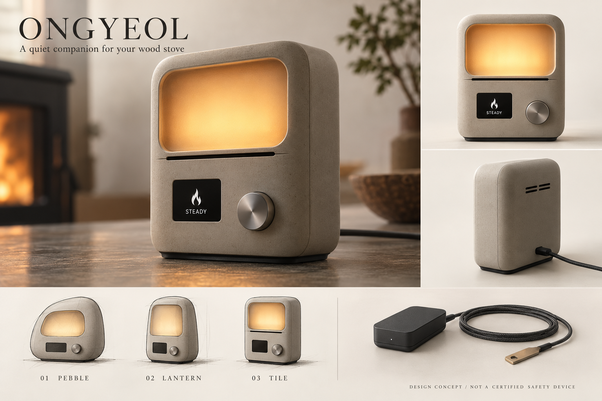

# 온결 / ONGYEOL

장작 난로의 온도 상태를 빛·상태 글자·물리 조작으로 전달하는 생활형 모니터. Oru에서 출발한 독립적인 새 제품 콘셉트다. 2026-11-02 작성.

## 기존 제품의 장단점 → 새 설계

Oru의 사양은 New Atlas 기사 본문에 근거한다. 실사용 시험은 하지 않았다. 원본 제품 사진은 웹 도구에서 가져오지 못했으므로 세부 형상 비평은 하지 않았다. 호두나무와 미니멀한 외형은 기사 설명에 한정한다.

| 확인한 Oru의 특징 | 장점 / 제약에 대한 해석 | 온결에 반영 |
|---|---|---|
| 온도 구간을 색으로 표현 | 휴대폰 확인 부담을 줄임. 색만으로는 의미 학습과 구별이 필요 | 넓은 확산광 유지 + 불꽃/장작/경고 아이콘과 상태 글자 병기 |
| 호두나무 몸체, 일반 램프 모드 | 생활 공간에 어울리고 계절 외 활용 가능 | 따뜻한 확산광과 무광 스톤색 몸체. 별도 조명 모드에서도 작은 모니터 상태 영역 유지 |
| 램프에 물리 버튼 없음, 앱 조작 | 외형은 간결하지만 빠른 조명 조절에도 앱 필요 | 누르고 돌리는 전면 다이얼. 회전=밝기, 짧게 누름=표시 전환, 경고 중 누름=일시 음소거 |
| 소리 없이 색 변화로 전달 | 일상을 방해하지 않음. 시야 밖에서는 알아차리기 어려울 수 있음 | 정상은 무음. 과열·측정불능은 소리와 글자로 구분하는 제안 |
| 두 장치 모두 USB-C 상시 전원과 Wi-Fi 필요 | 충전 관리 불필요. 설치 위치·연결 의존성 존재 | 센서–표시기 로컬 무선 직접 연결, 공유기·계정 없이 기본 사용. 상시 전원은 유지하여 배터리 관리와 난로 근처 충전지를 피함 |
| 앱에서 온도 구간·연통 종류 설정 | 설치 환경에 맞출 수 있음 | 기기에서 센서 종류와 난로 제조사 기준을 설정하는 초기 안내. 모든 난로에 같은 임계값 적용 금지 |

연결 단절·센서 고장 처리는 기사에서 확인되지 않았다. Oru에 해당 기능이 없다고 단정하지 않으며, 온결의 필수 설계 조건으로 추가한다.

## 형태 탐색과 추천

| 안 | 형태·사용 | 장점 | 대가 |
|---|---|---|---|
| 01 Pebble | 낮고 둥근 조약돌, 상부 광면 | 테이블에 자연스럽게 놓임 | 먼 곳에서 글자와 상태를 보기 어려움 |
| 02 Lantern | 손잡이가 있는 세로 랜턴 | 이동·측면 시인성 | 손잡이와 충전식 사용 기대, 부품 증가 |
| **03 Tile — 채택** | 안정적인 바닥의 세로 타일, 상부 빛·하부 정보·다이얼 | 시선이 빛 → 상태 → 조작으로 이어짐, 벽 가까이 배치 가능 | 방향성이 있어 설치 방향을 골라야 함 |

원목 스타일을 복제하기보다 ‘조용한 생활 오브제’라는 원리를 가져온다. 넓은 단일 발광면과 아래의 작은 조작부로 표현한다. 가칭이며 상표 확인은 하지 않았다.

## 사용자와 사용 흐름

가정: 장작 난로를 쓰며 다른 방에서 일하는 성인, 실내 콘센트가 있는 선반·책상. 제품은 난로에서 떨어진 생활 공간에 둔다. 휴대폰 앱은 이번 설계 범위에서 제외한다.

1. 난로·연통 제조사가 허용한 센서와 설치 위치를 확인한다. 단일벽 표면 센서와 이중벽용 승인 프로브를 별도 구성으로 취급한다. 이중벽 외벽 온도를 연소 온도로 환산하는 범용 보정은 제공하지 않는다.
2. 차가운 구역의 송신 박스에 센서를 연결하고 표시기와 페어링한다. 설치 거리는 일률적으로 정하지 않고 난로 이격 기준과 전자부품 온도 시험으로 결정한다.
3. 다이얼을 길게 눌러 설정을 열고 회전·누름으로 센서 유형과 제조사 권장 온도 구간을 확인한다. 설정 전에는 ‘설정 필요’만 표시한다.
4. 정상 사용 중 넓은 빛으로 주변 시야에서 상태를 보고, 가까이에서는 아이콘·글자·측정값과 측정 위치를 확인한다. 숫자는 표면/프로브 값을 명시한다.
5. 고온 또는 측정불능은 소리와 상태 글자로 알린다. 다이얼로 소리만 잠시 멈추며, 상태 표시는 유지한다. 난로 제어·자동 소화 기능은 없다.

## 상태 설계 초안

| 조건 | 빛 + 글자 | 소리·복구 |
|---|---|---|
| 설정 미완료 | 중립 흰색, 설정 필요 | 정상 온도 판정 안 함 |
| 설정된 운전 구간 | 호박색 고정, 불꽃 + 적정 | 무음 |
| 점화 후 운전 상태에 도달한 뒤 하한 아래로 하강 | 따뜻한 흰색의 느린 변화, 장작 + 보충 확인 | 낮은 온도만으로 장작량을 확정하지 않음 |
| 상한 초과 | 빨간색 + 삼각형 + 고온 확인 | 반복음. 짧게 누르면 60초 음소거하는 초안 |
| 단선·유효 패킷 15초 부재 | 중립 흰색 2회 변화 + 끊어진 연결 아이콘 + 측정 불가 | 주의음. 마지막 값을 현재 값처럼 표시하지 않음 |
| 정전 | 표시·모니터링 중단 | 백업 배터리 없음. 복전 시 유효 측정·설정 검증 후 판정 재개 |

15초·60초는 검증 전 UX 가정이다. 샘플 주기·응답 지연·재알림·히스테리시스는 시험 후 확정한다. 통신 실패 시 호박색으로 남는 동작은 허용하지 않는다. 조명 밝기 최소값도 상태 인지 시험 후 정한다. 음소거는 위험 해제·안전 확인 의미가 아니다.

## 치수·구조 초안

모든 치수는 디자인 가정이며 실측·부품 선정·공차 검증 전이다. [편집 가능한 배치도](layout.svg)는 기준 외형·부품 영역을 표시하며 제작 도면이 아니다.

| 항목 | 초안(mm) | 설계 이유 / 확인 필요 |
|---|---|---|
| 표시기 | W118 × H154 × D64 | 선반 배치, 전면 판독 면적 확보. 전도 시험 필요 |
| 확산창 | W96 × H66 | 멀리서 인식할 빛 면적. LED 혼색·핫스폿 시험 필요 |
| 하부 상태창 | W36 × H28 | 아이콘·짧은 상태 문구. 실제 패널 규격 미선정 |
| 누름 다이얼 | Ø22 | 손끝 조작. 축·장갑 사용·누름 하중 확인 필요 |
| 외벽 | 2.0 nominal | PC/ABS 후보, 일정 두께 유지. 수지 등급·난연·광학 조건·DFM 미확정 |
| 후면 정비 덮개 | 나사 체결 | 접착 봉인 대신 보드·USB-C 수리 접근 |

상부: 반투명 PC 확산창 → LED 보드 → 반사/차광 격벽. 하부: 상태 표시 보드와 다이얼, 후면 쪽 메인 보드·압전 부저. 하부 금속 추와 미끄럼 방지 발. 안테나는 금속 추에서 떨어진 후면 상부 영역을 우선 검토한다. 내부 영역은 예약 공간이며 실제 기성 부품 적합성을 검증하지 않았다.

센서부는 고온용 접촉 열전대/승인 프로브와 분리된 차가운 구역의 송신 박스 조합이다. MAX31856은 단선 검출 가능한 입력 회로 후보일 뿐 전체 계측 정확도나 장치 신뢰성을 보증하지 않는다. 로컬 무선은 페어링·CRC·순번·타임아웃을 설계하고, 지역별 무선 조건과 건물 내 도달성을 검증한다.

## 제작 방향과 대가

외형 시제품: 프린트 하우징 + 가공 확산판 + 별도 전자부품. 고온부 설치에 일반 프린트 수지를 사용하지 않는다. 양산 후보: PC/ABS 전후 하우징 사출, 광확산 PC 창, 가공/성형 알루미늄 다이얼, 체결식 내부 보드. 상부 확산창은 기계식 고정과 차광 격벽으로 정비 가능하게 한다. 나사·보스·드래프트·파팅은 제조사 DFM에서 확정한다.

기존보다 표시창·다이얼·부저·로컬 통신이 추가돼 BOM과 펌웨어 복잡성이 늘어난다. 화면과 부저를 넣고도 가격이 내려간다고 주장하지 않는다. 생산 수량·견적 미정으로 확정 원가·판매가는 제시하지 않는다. 배터리를 빼서 정전 모니터링 문제는 남는다.

## 실제 확인과 다음 검증

- 확인: 기사 본문과 부품·공정·유사 계측 제품의 공식 설명 확인. 형태 3안 비교, 동일 기준 크기의 전면/측면/배치도 작성, 생성 이미지 육안 검토.
- 도달 수준: 외형 콘셉트 + 치수·구조 초안. CAD·회로·펌웨어·실물 제작·성능 시험·인증은 미수행.
- 다음: 실제 패널·엔코더·전원·안테나 부품 배치와 공차 확인, 조명 핫스폿/색 구별/글자 시인성, 다이얼 오조작·전도, 센서 접촉·단선·설치 오차·온도 응답, 통신 단절·복구·전원 재시작 시험.
- 목표 시험 예: 라우터를 꺼도 로컬 상태 수신, 센서 단선 시 적정 표시 제거, 패킷 중단 후 타임아웃 내 측정불가 표시, 고온 경고 음소거 후 표시 유지. 아직 시험 결과는 없다.
- 난로 상태 보조 모니터의 개념 설계다. 화재·일산화탄소 감지기나 인증된 안전장치를 대체하지 않는다.

## 출처와 확인 범위

확인일: 2026-11-02. 직접 인용 대신 요약·설계 해석으로 작성.

- [New Atlas / Oru 기사](https://newatlas.com/around-the-home/oru-wood-stove-lamp/): 제품 구성·색/소리·전원/통신·앱·버튼에 관한 본문 확인. 외형 사진 접근 실패, 성능 실측 없음.
- [Oru 공식 사이트](https://www.getoru.com/), [Kickstarter](https://www.kickstarter.com/projects/neils/oru-the-calm-way-to-watch-your-wood-stove/description): 도구에서 상세 본문 확보 불가. 공식 사양 검증 근거로 사용하지 않음.
- [Condar / Stovepipe thermometers](https://www.condar.com/Stovepipe_Thermometers.html): 단일벽 자석 표면계와 이중벽 프로브 권고 확인 → 센서 구성 분리. 특정 난로의 설치 승인을 의미하지 않음.
- [Analog Devices / MAX31856](https://www.analog.com/en/products/max31856.html): 열전대 종류·냉접점 보상·단선 검출 기능 확인 → 입력 회로 후보. 완제품 정확도 추정 안 함.
- [Protolabs / 사출 가이드](https://www.protolabs.com/services/injection-molding/plastic-injection-molding/design-guidelines/): PC/ABS 재료별 벽 두께 범위와 공정 지침 확인 → 2mm 초기 가정. 제조 가능 판정·견적 아님.

이미지는 내장 image_gen으로 만든 외형 콘셉트다. [프롬프트](prompt.txt)를 함께 보존한다. 렌더의 곡률·치수·부품 맞물림은 제작 근거가 아니며 기준 치수와 배치도를 우선한다.

육안 검토: 렌더의 주요 뷰에서 상부 광면·좌측 상태창·우측 다이얼·스톤색 몸체가 일치한다. 상태창은 생성 결과를 반영해 초기 W58×H25에서 W36×H28로 수정했다. 후면 나사와 센서 송신기의 전원선은 렌더에서 생략됐으며 구조 설명이 기준이다. 하단 Lantern 탐색 그림에는 손잡이가 표현되지 않아 세로 비례 비교로만 사용한다. 실제 설치 이격을 표현한 사진이 아니다. 프롬프트는 최초 생성 지시 원문이므로 수정된 치수표와 구분한다.
